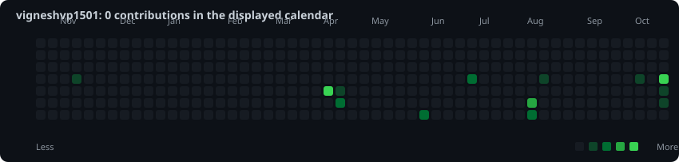

# `vigneshvp1501@github ~ $`

A small animated GitHub profile built with Python, SVG, and GitHub Actions.

  

<table>
  <tr>
    <td valign="top"></td>
    <td valign="top"></td>
  </tr>
</table>

---

### `$ whoami`
M.Tech Cloud Computing | Full-stack development | AWS and automation

### `$ stack`
Python · Java · AWS · Linux · Docker · FastAPI · React · Node.js · PostgreSQL

### `$ highlights`
- Building and deploying full-stack applications.
- Exploring AI-driven cloud resource optimization.
- Automating infrastructure and developer workflows.
